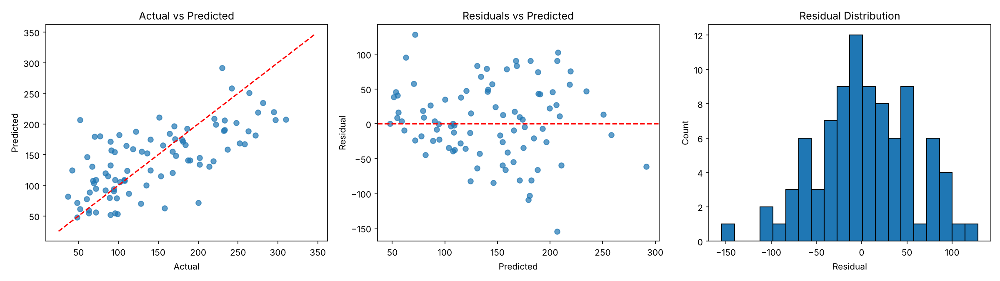

# Simple Predictive Model: Diabetes Progression (Linear Regression)

A beginner machine learning project that trains and evaluates a baseline **Linear Regression** model with Scikit-learn.

## Problem
Predict a continuous measure of diabetes disease progression one year after baseline from 10 patient measurements. This is a **regression** task.

## Dataset
Scikit-learn's built-in Diabetes dataset (`sklearn.datasets.load_diabetes`): 442 samples, 10 numeric features, no missing values. No download is needed.

## Pipeline
1. Load data and define the problem
2. Separate features (X) and target (y)
3. 80/20 train/test split with `random_state=42`
4. Train a mean baseline and Linear Regression
5. Evaluate with MSE, RMSE, MAE and R²
6. Plot actual vs predicted, residuals vs predicted, and the residual distribution

## Results (test set)
| Model | MSE | RMSE | MAE | R² |
|---|---|---|---|---|
| Mean baseline | 5361.5 | 73.2 | 64.0 | -0.012 |
| Linear Regression | 2900.2 | 53.9 | 42.8 | 0.453 |

See [docs/findings.md](docs/findings.md) for the full report.



## How to run
```bash
git clone <this-repo-url>
cd <repo-folder>
pip install -r requirements.txt
jupyter notebook notebooks/model_training.ipynb
```
Run all cells from top to bottom. The plot is saved to `images/evaluation_plots.png`.

## Structure
```
README.md
requirements.txt
notebooks/model_training.ipynb
docs/findings.md
images/evaluation_plots.png
```
